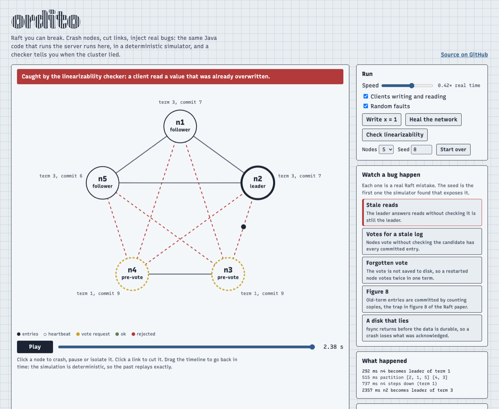

<div align="center">

# ordito

**Raft you can break.** A from-scratch Raft in modern Java, a deterministic simulator that replays any
failure from a seed, a linearizability checker, and [loomkv](https://github.com/AndreaAcanfora/loomkv)
turned into a replicated, Redis-compatible store on top of it.

[](https://github.com/AndreaAcanfora/ordito/actions/workflows/ci.yml)
[](pom.xml)
[](LICENSE)

**[Open the playground](https://andreaacanfora.github.io/ordito/)**: crash nodes, cut links and watch
real Raft bugs happen, in your browser.

[](https://andreaacanfora.github.io/ordito/?bug=stale-reads)

</div>

---

Distributed systems fail in interleavings nobody thinks to test: a message delayed past an election, a
node that restarts between two votes, a leader that pauses for a second and wakes up still sure it
leads. ordito is built so those interleavings are cheap to find and exact to replay.

- **The Raft core is a pure state machine.** No threads, no sockets, no clock, no disk: messages and
  ticks go in, messages and disk writes come out. The same code runs the real server, the simulator,
  and the browser playground.
- **The simulator runs a whole cluster in one thread from one seed.** Network loss, duplication,
  reordering, partitions, crashes, pauses and clock skew are all decided by the seed, so a failure is a
  number you can replay, step by step, as many times as you like. A laptop simulates about 25
  cluster-hours a minute.
- **Every run is checked twice.** Raft's safety properties after every single event, and the clients'
  history for linearizability at the end.
- **It finds real bugs.** Five classic Raft mistakes can be switched on, and the simulator catches each
  one, from a seed you can open in the playground. It also found bugs in ordito itself while it was
  being written (see [below](#what-the-simulator-found-in-ordito-itself)).

## Try it

Java 25 or newer:

```bash
git clone --recursive https://github.com/AndreaAcanfora/ordito && cd ordito
mvn -q package -DskipTests
```

Run 10,000 simulated clusters with faults, each checked for safety and linearizability:

```console
$ java -jar ordito-sim/target/ordito-sim.jar --runs 10000
running 10000 seeds from 1 on 10 threads...
10000 runs, 0 failures: 66.9 hours of cluster time simulated in 163.4 s.
```

Now break Raft on purpose. `forget-vote` does not save the vote to disk, so a node that restarts mid
election can vote twice in the same term:

```console
$ java -jar ordito-sim/target/ordito-sim.jar --nodes 3 --runs 2000 --bug forget-vote
injected bug: forget-vote (the vote is not saved, so a restarted node can vote twice in one term)
running 2000 seeds from 1 on 10 threads...
found after 5.4 s (147 runs finished)

FAILED: ELECTION_SAFETY in seed 146
  nodes 1 and 2 are both leader of term 6
  environment: batch 2, 1% loss, 10% duplicates, latency up to 60 ms, a fault every ~300 ms

  last events:
      ...
      6351 ms  n2 steps down (term 5)
      6367 ms  n1 becomes leader of term 6
      6444 ms  n3 crashed
      6481 ms  n3 restarted (term 6, 61 entries on disk)
      6573 ms  n1 crashed
      6781 ms  n2 clock now ticks every 13 ms
      6975 ms  network healed
      7216 ms  bridge: n2 is the only link between the two sides
      7227 ms  VIOLATION ELECTION_SAFETY: nodes 1 and 2 are both leader of term 6

  replay it, event by event: java -jar ordito-sim.jar --seed 146 --bug forget-vote --nodes 3 --log
```

n3 voted for n1 in term 6, crashed, came back with term 6 on disk but no vote, and voted again for n2.
Watch the same seed fail in the browser: [`?bug=forget-vote&seed=146&nodes=3`](https://andreaacanfora.github.io/ordito/?bug=forget-vote&seed=146&nodes=3).

Start a replicated cluster and use it with any Redis client:

```console
$ java -jar ordito-server/target/ordito-server.jar --demo
ordito 0.1.0 demo: 3 nodes on ports 6381-6383. Try: redis-cli -c -p 6381

$ redis-cli -c -p 6381 set greeting ciao
OK
$ redis-cli -c -p 6383 get greeting      # a follower redirects to the leader
"ciao"
$ redis-cli -p 6382 raft status
id:2
role:leader
term:2
...
```

And attack real processes the way [Jepsen](https://jepsen.io) does:

```console
$ java -jar ordito-chaos/target/ordito-chaos.jar --server ordito-server/target/ordito-server.jar --time 60
    0.5 s  cluster up, leader n3
    4.1 s  nemesis: isolate the leader, n3
   11.1 s  nemesis: kill -9 n2
   30.8 s  nemesis: SIGSTOP n1 (the leader)
   ...
   47.2 s  13403 operations: 13375 ok, 6 failed (did not happen), 22 unknown (may have happened)
   47.2 s  linearizability check of 13386 operations: LINEARIZABLE (0.1 s, 14576 states)
   47.2 s  PASS: the history is linearizable.
```

## The bugs it catches

Each bug is a one-line change to correct Raft, behind a flag. The seed is the first one, counting from
1, that exposes it; the playground link replays exactly that run.

| Bug | What goes wrong | Caught by | Seed |
|---|---|---|---|
| `stale-reads` | The leader answers reads from its own state at once. A leader that was cut off, or a new one that does not yet know the commit index, returns old data. | the linearizability checker | [5 nodes, seed 8](https://andreaacanfora.github.io/ordito/?bug=stale-reads&seed=8&nodes=5) |
| `vote-for-stale-log` | Votes ignore whether the candidate's log is up to date, so a leader can be elected without committed entries. | leader completeness | [5 nodes, seed 1](https://andreaacanfora.github.io/ordito/?bug=vote-for-stale-log&seed=1&nodes=5) |
| `forget-vote` | The vote is not saved to disk; a restarted node votes twice in one term and two leaders share it. | election safety | [3 nodes, seed 146](https://andreaacanfora.github.io/ordito/?bug=forget-vote&seed=146&nodes=3) |
| `commit-previous-term` | Old-term entries are committed by counting replicas: the trap in figure 8 of the Raft paper. | leader completeness | [3 nodes, seed 1071](https://andreaacanfora.github.io/ordito/?bug=commit-previous-term&seed=1071&nodes=3) |
| `lying-fsync` | The disk acknowledges writes before they are durable; a crash loses acknowledged entries. | leader completeness | [3 nodes, seed 1](https://andreaacanfora.github.io/ordito/?bug=lying-fsync&seed=1&nodes=3) |

The test suite pins these seeds, so CI fails if the simulator ever stops catching one of them.

## How it works

```
                    ┌─────────────────────────────┐
  ticks ──────────▶ │                             │ ──▶ messages to send
  messages ───────▶ │   RaftNode (ordito-raft)    │ ──▶ entries + vote to persist
  propose / read ─▶ │   a pure state machine      │ ──▶ committed entries to apply
                    │                             │ ──▶ reads that are safe to serve
                    └─────────────────────────────┘
             driven by:  the simulator  |  the real server  |  the browser
```

**[ordito-raft](ordito-raft/src/main/java/io/github/andreaacanfora/ordito/raft/RaftNode.java)**: leader
election with pre-vote (a node that was cut off cannot disrupt the cluster when it returns) and
check-quorum (a leader cut off from the majority steps down); log replication with pipelining, fast
backtracking by term and a probe state; the rule that only entries of the leader's own term are
committed by counting; linearizable reads with ReadIndex. The host calls `ready()` and must persist,
then send, then apply, in that order, as in etcd's raft.

**[ordito-sim](ordito-sim/src/main/java/io/github/andreaacanfora/ordito/sim/Simulation.java)**: one
priority queue of events in simulated time, one seeded random generator split per concern (network,
faults, clients, nodes). The fault injector partitions the network (including "bridges", where one node
is the only link between two halves), isolates or kills the leader, crashes and restarts nodes (memory
lost, disk kept), pauses them like a long GC, and skews their clocks. Swarm testing lets the seed also
pick the environment: batch sizes from 1 to 64, loss from 0 to 20 %, latency from 2 to 60 ms. After every
event the simulator checks election safety, state machine safety and leader completeness; at the end it
heals everything, requires the cluster to recover, and checks the history.

**[ordito-check](ordito-check/src/main/java/io/github/andreaacanfora/ordito/check/Linearizability.java)**:
the Wing and Gong search with Lowe's memoization, the algorithm behind Knossos and Porcupine. Operations
whose outcome is unknown (a timeout, a dropped connection) may or may not have taken effect, and the
checker considers both. Histories are split per key. When a history is not linearizable it names the
operation that cannot be placed and the ones concurrent with it.

**[ordito-server](ordito-server/src/main/java/io/github/andreaacanfora/ordito/server/ReplicatedServer.java)**:
loomkv's unmodified command implementations, replicated. One virtual thread owns Raft and the database;
everything that queues up while it fsyncs shares the next fsync. To make commands deterministic on
every replica, each log entry carries the leader's timestamp, and the state machine's clock is that
timestamp: `SET k v EX 10` expires at the same instant everywhere. Writes go through the log, reads
through ReadIndex, and followers answer `MOVED` to the leader, which `redis-cli -c` follows. The log is
checksummed, torn tails are cut on start, and the term and vote are fsynced before any message that
depends on them. The leader sends entries to followers while it writes them to its own disk (section
10.2.1 of the Raft thesis).

**[ordito-chaos](ordito-chaos/src/main/java/io/github/andreaacanfora/ordito/chaos/Main.java)**: starts
real server processes, routes every link between them through a TCP proxy it can cut, and runs
concurrent clients while it isolates leaders, partitions, `kill -9`s and `SIGSTOP`s nodes. Then the same
checker judges the history.

**[The playground](ordito-playground/)**: [TeaVM](https://teavm.org) compiles the Raft core, the
simulator and the checker to JavaScript. The random generator is written out by hand rather than taken
from the JDK, so a seed produces the same run in the browser as on the JVM; CI compares the two on 30
seeds, down to a digest of every client operation. Going back in time re-creates the simulation from its
seed and replays your actions.

## What the simulator found in ordito itself

- **A message storm.** Under a lossy, duplicating network, every duplicated rejection made the leader
  resend, and each resend could be duplicated again: one seed produced 10 million messages in 24
  simulated seconds. The fix is the probe state etcd uses: after a rejection, at most one AppendEntries
  per heartbeat until the follower accepts one.
- **A wrong invariant.** The first leader-completeness check flagged seed 322 without any bug injected:
  a node had become leader of term 19 after term 20 had committed entries. That is legal (the votes were
  cast in term 19 and delivered late), and the paper's property is about entries committed in *earlier*
  terms. The check now tracks the term in which each entry was committed.
- **Check-quorum hides stale reads, almost.** With real processes, the `stale-reads` bug went unseen for
  a minute of faults: a partitioned leader steps down before the other side can elect a new one and
  commit, so the window is tiny. The simulator still finds it, through a newly elected leader that
  answers before it knows the commit index. For the chaos test, `--unsafe-stale-reads` also turns off
  check-quorum, the classic broken lease read, and the checker catches it within seconds.

## Numbers

On a 10-core Apple M-series laptop: a 24-second simulated run of a 5-node cluster takes 0.1 to 0.2 s on
the JVM and 0.05 to 0.3 s in the browser; 10,000 runs take under three minutes. The replicated server is
bound by fsync: on macOS `FileChannel.force` is a full flush of the drive cache, so three nodes sharing
one laptop SSD do about 1,400 writes/s with 50 clients, and reads (ReadIndex, no disk) 12,000 to 19,000/s.
CI prints a `redis-benchmark` run on Linux in its summary.

## Limits

This is a learning and showcase project, and it says what it does not do:

- no snapshots or log compaction: the log grows forever and a restart replays all of it;
- no membership changes: the cluster is fixed at start;
- pub/sub, `MULTI` and blocking commands are not replicated (pub/sub answers an error);
- one Raft group for the whole keyspace;
- the chaos harness needs a Unix-like OS for `SIGSTOP`.

## Layout

| Module | |
|---|---|
| [`ordito-raft`](ordito-raft) | Raft as a pure state machine. No dependencies. |
| [`ordito-check`](ordito-check) | The linearizability checker. No dependencies. |
| [`ordito-sim`](ordito-sim) | The deterministic simulator and its command line. |
| [`ordito-server`](ordito-server) | loomkv replicated with Raft. |
| [`ordito-chaos`](ordito-chaos) | Jepsen-style tests of real processes. |
| [`ordito-playground`](ordito-playground) | The simulator in the browser (built with `-Pplayground`). |
| [`loomkv`](https://github.com/AndreaAcanfora/loomkv) | Git submodule: the single-node server whose commands ordito replicates. |

Build everything and run the tests with `mvn verify`; build the playground with
`mvn install -DskipTests && mvn -Pplayground -pl ordito-playground package`, then serve
`ordito-playground/target/site`.

## Further reading

- Diego Ongaro and John Ousterhout, [In Search of an Understandable Consensus Algorithm](https://raft.github.io/raft.pdf), and Ongaro's [PhD thesis](https://web.stanford.edu/~ouster/cgi-bin/papers/OngaroPhD.pdf).
- [etcd's raft](https://github.com/etcd-io/raft), whose `Ready` interface ordito follows.
- [FoundationDB](https://apple.github.io/foundationdb/testing.html) and [TigerBeetle](https://github.com/tigerbeetle/tigerbeetle/blob/main/docs/internals/vopr.md) on deterministic simulation testing.
- Kyle Kingsbury's [Jepsen analyses](https://jepsen.io/analyses), and [Porcupine](https://github.com/anishathalye/porcupine).

## License

MIT
